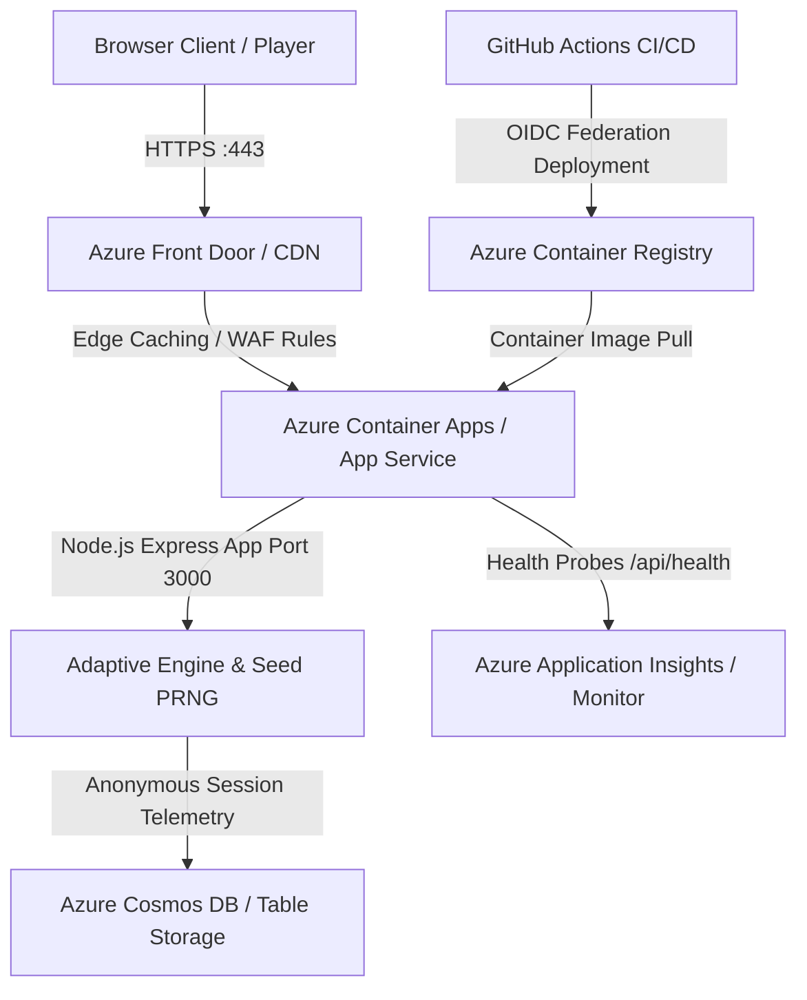

# Azure Hosting & Cloud Deployment Architecture Design
## PS09: Adaptive Memory Matching Game (Synapse Engine)

### 1. Executive Architecture Overview

Synapse is built on a high-throughput, low-latency Node.js & Express server serving static cyber-neuromorphic frontend assets and RESTful telemetry/calibration microservices.



---

### 2. Recommended Hosting Service: Azure Container Apps (ACA)

| Requirement | ACA Solution | Azure App Service Alternative |
| :--- | :--- | :--- |
| **Containerization** | Native Docker support with serverless micro-billing. Scales to zero when idle. | Standard B1 Linux plan ($13/month). |
| **Health Probes** | Integrated `/api/health` liveness and readiness probe checks every 30s. | App Service AlwaysOn health check. |
| **Global Latency** | Coupled with Azure Front Door for global edge delivery of static assets. | App Service custom domain + CDN. |
| **Autoscaling** | KEDA HTTP-based autoscaling (scales 0 -> 10 instances on concurrent players). | Azure App Service Metric Scale rules. |

---

### 3. Automated CI/CD Deployment Workflow (GitHub Actions to Azure)

```yaml
# .github/workflows/deploy-azure.yml
name: Deploy Synapse to Azure Container Apps

on:
  push:
    branches: [ main ]

permissions:
  id-token: write
  contents: read

jobs:
  build-and-deploy:
    runs-on: ubuntu-latest
    steps:
      - uses: actions/checkout@v4

      - name: Azure Login via OIDC
        uses: azure/login@v2
        with:
          client-id: ${{ secrets.AZURE_CLIENT_ID }}
          tenant-id: ${{ secrets.AZURE_TENANT_ID }}
          subscription-id: ${{ secrets.AZURE_SUBSCRIPTION_ID }}

      - name: Build and Push Docker Image to Azure Container Registry (ACR)
        run: |
          az acr build \
            --registry ${{ secrets.AZURE_ACR_NAME }} \
            --image synapse-ps09:${{ github.sha }} .

      - name: Deploy Image to Azure Container App
        uses: azure/container-apps-deploy-action@v2
        with:
          acrName: ${{ secrets.AZURE_ACR_NAME }}
          containerAppName: synapse-matrix-app
          resourceGroup: rg-synapse-prod
          image: ${{ secrets.AZURE_ACR_NAME }}.azurecr.io/synapse-ps09:${{ github.sha }}
          targetPort: 3000
```

---

### 4. Infrastructure-as-Code (Bicep Template)

```bicep
param location string = resourceGroup().location
param appName string = 'synapse-ps09'

resource logAnalytics 'Microsoft.OperationalInsights/workspaces@2022-10-01' = {
  name: '${appName}-logs'
  location: location
  properties: {
    sku: { name: 'PerGB2018' }
  }
}

resource appEnv 'Microsoft.App/managedEnvironments@2023-05-01' = {
  name: '${appName}-env'
  location: location
  properties: {
    appLogsConfiguration: {
      destination: 'log-analytics'
      logAnalyticsConfiguration: {
        customerId: logAnalytics.properties.customerId
        sharedKey: logAnalytics.listKeys().primarySharedKey
      }
    }
  }
}

resource containerApp 'Microsoft.App/containerApps@2023-05-01' = {
  name: appName
  location: location
  properties: {
    managedEnvironmentId: appEnv.id
    configuration: {
      ingress: {
        external: true
        targetPort: 3000
        transport: 'auto'
      }
    }
    template: {
      containers: [
        {
          name: 'web'
          image: 'mcr.microsoft.com/azuredocs/aci-helloworld:latest'
          resources: {
            cpu: json('0.5')
            memory: '1.0Gi'
          }
          probes: [
            {
              type: 'Liveness'
              httpGet: {
                path: '/api/health'
                port: 3000
              }
              periodSeconds: 30
            }
          ]
        }
      ]
      scale: {
        minReplicas: 0
        maxReplicas: 5
      }
    }
  }
}
```

---

### 5. Cost & Resilience Estimation

| Tier | Resources Used | Estimated Monthly Cost | Performance Profile |
| :--- | :--- | :--- | :--- |
| **Dev / Academic Evaluation** | Azure Container Apps (0.5 vCPU, 1GB RAM) with scale-to-zero | **$0.00 - $3.00 / month** (First 180k vCPU seconds free) | < 150ms cold start, sub-20ms warm responses |
| **Production Matrix** | Azure Container Apps + Azure Front Door Standard + Cosmos DB Serverless | **~$35.00 / month** | Global 99.99% availability, DDoS defense, unlimited concurrent test sessions |
