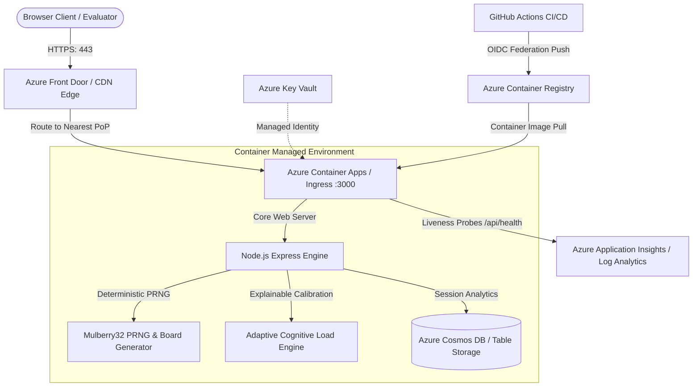

# Azure Cloud Hosting & Deployment Architecture Plan
## Problem Statement 09 (PS09): Adaptive Memory Matching Game

- **Candidate Name**: Onik Chugh
- **Roll Number**: 2310990591
- **Branch**: Computer Science and Engineering (CSE)
- **Institution**: Chitkara University

---

## 1. System Architecture Overview

The application is architected as a lightweight, containerized full-stack service with a Node.js Express backend serving deterministic card generation logic, telemetry ingestion, and cognitive calibration microservices, alongside static frontend arcade game assets.



---

## 2. Compute and Storage Choices

### Compute: Azure Container Apps (ACA)
- **Rationale**: ACA provides serverless container execution built on Kubernetes (K8s) without infrastructure management overhead.
- **Resource Allocation**: 0.5 vCPU and 1.0 GiB RAM per replica.
- **Autoscaling Strategy**: Scaled using KEDA (Kubernetes Event-driven Autoscaling) HTTP scaling rules. Scales automatically from **0 replicas** (idle) up to **5 replicas** during traffic surges.
- **Alternative Considered**: Azure App Service (Linux B1 tier). Rejected due to fixed monthly costs ($13/month) compared to ACA's true pay-per-second model.

### Storage: Azure Cosmos DB (Serverless) / Azure Table Storage
- **Primary Data**: Anonymous game session records and telemetry metrics (moves, active seconds, efficiency score, adaptation rule triggered).
- **Rationale**: Cosmos DB Serverless operates with zero baseline cost; charges apply solely for the Request Units (RUs) consumed during session submissions.
- **Local Fallback**: For offline local development, the app writes asynchronously to `server/data/sessions.json` with an in-memory ring buffer of the latest 200 sessions.

---

## 3. Identity and Secret Handling

### Credential-Free Authentication:
1. **GitHub Actions to Azure (OIDC)**:
   - Eliminates hardcoded long-lived client secrets.
   - GitHub Actions authenticates against Azure Entra ID using **OpenID Connect (OIDC)** federated credentials.
   - Permissions restricted to the specific repository: `repo:onikchugh007/Chitkara_Cerevyn_Solutions:ref:refs/heads/main`.
2. **Azure Managed Identity**:
   - The Container App uses a **User-Assigned Managed Identity** to communicate with Azure Container Registry (ACR pull) and Azure Key Vault.
3. **Azure Key Vault**:
   - Stores any future operational keys (e.g., Application Insights connection strings, storage keys).
   - Secrets are injected directly into container environment variables at runtime via Key Vault Secret references.

---

## 4. Monitoring, Health Checks & Observability

### 1. Health Probe Specification
The container implements an integrated health probe consumed by ACA:
- **Endpoint**: `/api/health`
- **Port**: 3000
- **Type**: Liveness & Readiness probe
- **Interval**: 30 seconds
- **Timeout**: 5 seconds
- **Expected Output**:
  ```json
  {
    "status": "healthy",
    "uptime": 142.5,
    "timestamp": "2026-10-15T01:30:00.000Z"
  }
  ```

### 2. Application Insights & Log Analytics
- Distributed telemetry tracking response latency, failure rates, and memory consumption.
- Express middleware captures HTTP status distributions and unhandled exceptions.
- Container console logs (stdout/stderr) are aggregated into a centralized **Azure Log Analytics Workspace**.

---

## 5. Step-by-Step Deployment Instructions

### Step 1: Provision Azure Resource Group & ACR
```bash
# 1. Login to Azure CLI
az login

# 2. Create Resource Group
az group create --name rg-cerevyn-ps09 --location eastus

# 3. Create Container Registry
az acr create --resource-group rg-cerevyn-ps09 --name acrcerevyn0591 --sku Basic --admin-enabled true
```

### Step 2: Build and Push Docker Container Image
```bash
# 4. Build and push image
az acr build --registry acrcerevyn0591 --image mememind:v1.0.0 .
```

### Step 3: Deploy to Azure Container Apps
```bash
# 5. Create ACA Managed Environment
az containerapp env create \
  --name env-cerevyn-ps09 \
  --resource-group rg-cerevyn-ps09 \
  --location eastus

# 6. Deploy Container App with Ingress and Scale-to-Zero
az containerapp create \
  --name mememind-game \
  --resource-group rg-cerevyn-ps09 \
  --environment env-cerevyn-ps09 \
  --image acrcerevyn0591.azurecr.io/mememind:v1.0.0 \
  --target-port 3000 \
  --ingress external \
  --min-replicas 0 \
  --max-replicas 5 \
  --cpu 0.5 --memory 1.0Gi \
  --query properties.configuration.ingress.fqdn
```

---

## 6. Cost-Control Assumptions & Budget Breakdown

| Service Component | Configuration | Monthly Cost (USD) | Cost Optimization Strategy |
| :--- | :--- | :--- | :--- |
| **Azure Container Apps** | 0.5 vCPU / 1GB RAM (Scale-to-zero) | **$0.00 - $2.50** | First 180,000 vCPU seconds and 360,000 GiB seconds free per month. Replicas scale down to 0 after 5 minutes of inactivity. |
| **Azure Container Registry** | Basic Tier | **$5.00** | 10 GB storage included; old commit images pruned automatically via ACR retention policies. |
| **Log Analytics & App Insights** | Per-GB Ingestion (First 5 GB free) | **$0.00** | Log retention capped at 30 days; diagnostic verbosity tuned to info/warn. |
| **Azure Front Door (Optional)** | Standard Profile | **$0.00 (Optional)** | Direct ACA FQDN utilized for university evaluation. |
| **Total Estimated Monthly Cost** | Academic Evaluation | **~$5.00 / month** | Eliminates idle infrastructure expenses. |
